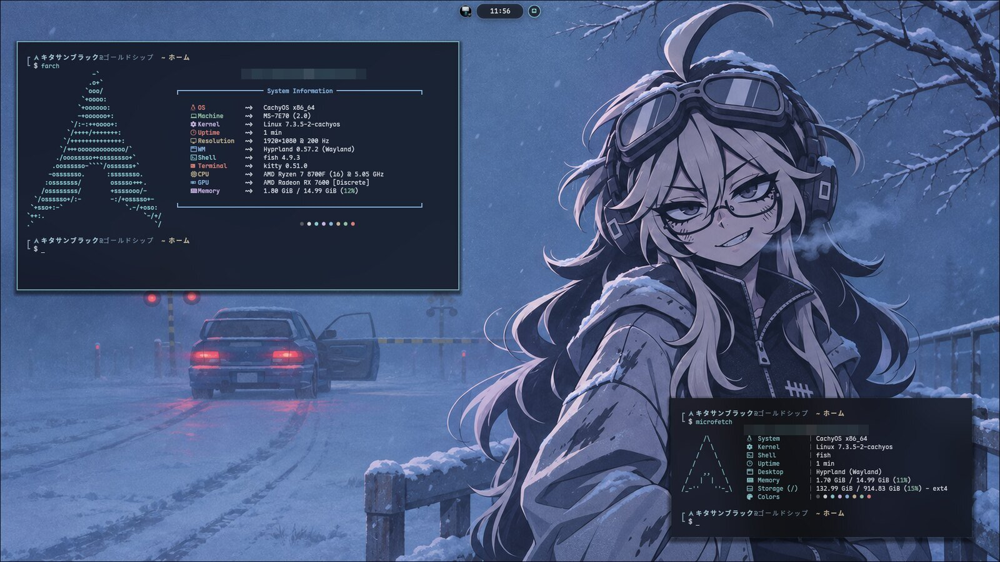
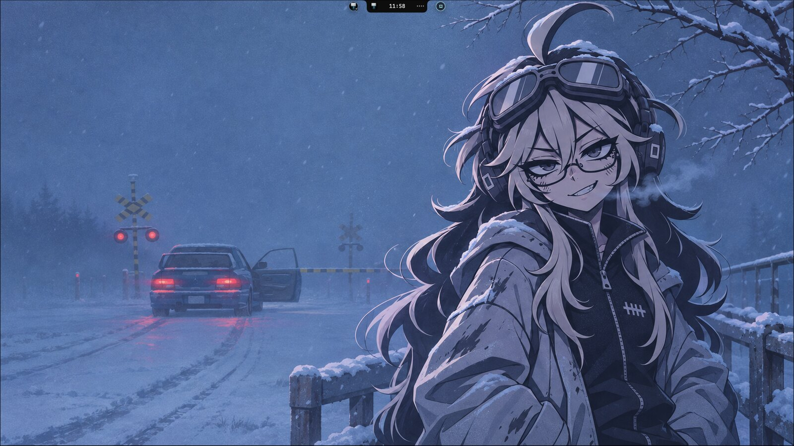
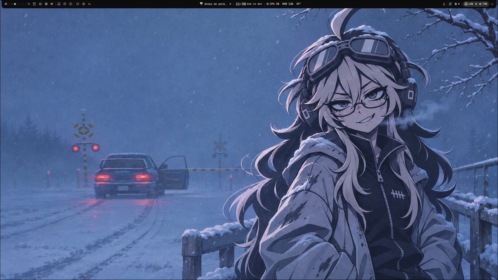
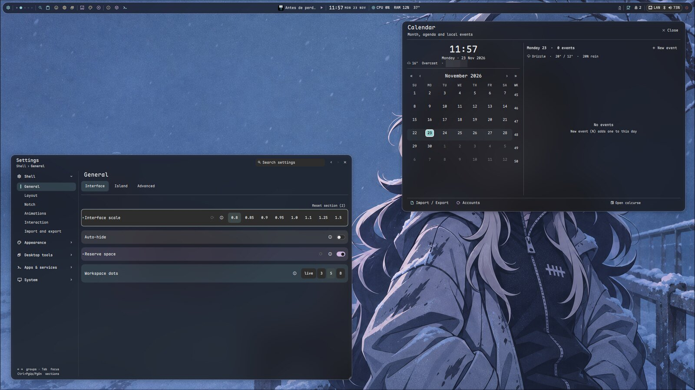
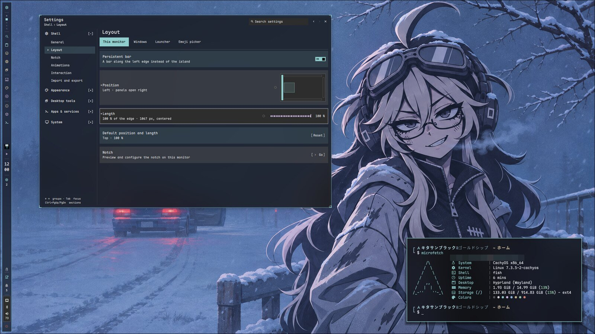
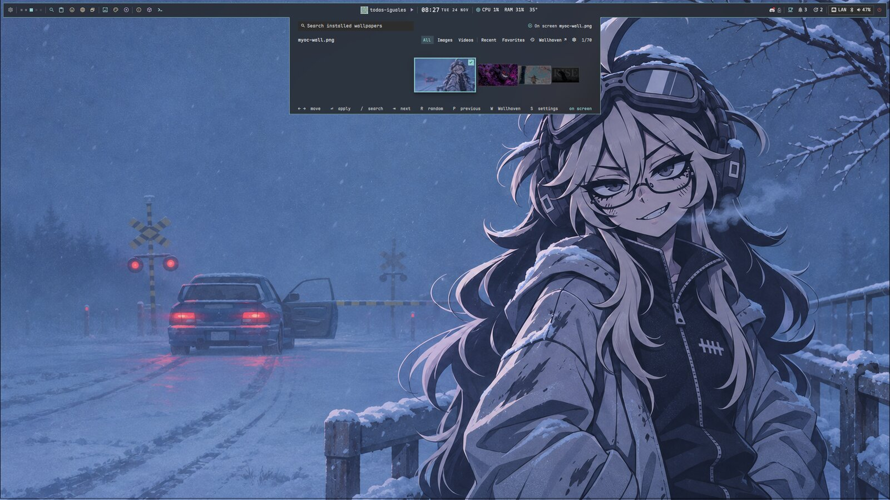
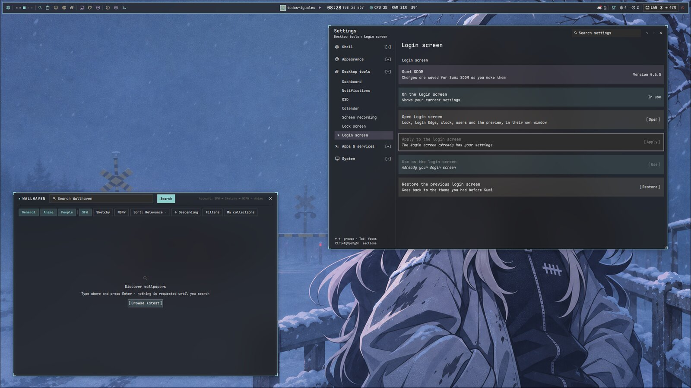

# Sumi-Files

Dotfiles for a **Hyprland** desktop on Arch Linux / CachyOS: a Lua-configured
compositor, a `systemd --user` session, a static palette with optional
wallpaper-driven colours (matugen), Fish, Kitty, Hyprlock, GTK/Qt theming —
plus two tools to keep it backed up: **`dotbackup`** and **`diskbackup`**.

<p align="center">
  
</p>

> Sumi-Files is a configuration to read and adapt, not a turnkey distribution.
> Nothing here is installed without you asking for it, and nothing is
> overwritten without a backup.

## Gallery

The bar, panels and windows in these screenshots are
[Sumi Shell](https://github.com/kitasael-burakku/Sumi-Shell); the compositor,
terminals, colours and window borders are Sumi-Files.

| | |
| --- | --- |
| <br>**Edge** | <br>**Bar-Edge** |
| <br>**Dynamic Bar** with Settings and Calendar | <br>**Dynamic Bar on the left edge** with a terminal |
| <br>**Wallpaper picker** | <br>**Wallhaven browser** and Settings |

## Contents

| Path | What it is |
|---|---|
| [`config/`](config) | The configuration itself. `config/<x>` goes to `~/.config/<x>`. |
| [`sumi-files.list`](sumi-files.list) | The manifest: which paths Sumi-Files manages. Read by the installer and by `dotbackup`. |
| [`install.sh`](install.sh) | Optional installer (copy or symlink, dry run, automatic backups). |
| [`bin/dotbackup`](bin/dotbackup) | Mirror your live config back into this repository, then commit/push. |
| [`bin/diskbackup`](bin/diskbackup) | Mirror repositories, private files and a system inventory to a second disk. |
| [`hooks/dotbackup/`](hooks/dotbackup) | Checks `dotbackup` runs before committing (privacy, keybind docs, …). |
| [`hooks/git/`](hooks/git) | `pre-commit` with the same privacy/secret checks for any commit (`git config core.hooksPath hooks/git`). |
| [`share/examples/`](share/examples) | Settings templates for the tools. |
| [`docs/`](docs) | Documentation (below). |
| [`tests/`](tests) | Test suite: `tests/run.sh`. |

## Quick start

**Read first:** [docs/DEPENDENCIES.md](docs/DEPENDENCIES.md) lists the packages;
[docs/CONFIGURATION.md](docs/CONFIGURATION.md) lists the values you must adapt
(monitor, input devices, GPU, wallpaper…).

```bash
git clone https://github.com/kitasael-burakku/Sumi-Files.git ~/Projects/Sumi-Files
cd ~/Projects/Sumi-Files
```

**Option A — installer** (preview first; replaced files are moved to
`~/.local/state/sumi-files/backups/<date>/`):

```bash
./install.sh --dry-run
./install.sh                  # asks before changing anything
./install.sh --with-tools     # also installs dotbackup and diskbackup
```

**Option B — by hand:** copy only what you want, following
[docs/INSTALLATION.md § Manual installation](docs/INSTALLATION.md#manual-installation).
Both paths end in the same state.

**Already have a configuration** on this machine (devices, monitors, files
that must stay different)? Follow [docs/MIGRATING.md](docs/MIGRATING.md).

## The backup tools

```bash
dotbackup --check             # is the repository behind ~/.config? (exit 2 = yes)
dotbackup --dry-run           # what would be copied
dotbackup                     # sync, review, commit, push — asking at each step
dotbackup --yes --commit      # the same, unattended (no push unless --push)

diskbackup --init             # once: mark the destination folder
diskbackup --dry-run          # what would be written
diskbackup                    # back up
diskbackup --check            # anything pending? (exit 2 = yes)
```

Manuals: [docs/DOTBACKUP.md](docs/DOTBACKUP.md) · [docs/DISKBACKUP.md](docs/DISKBACKUP.md).
`dotbackup` also works with a repository of your own:
[docs/DOTBACKUP.md § Using your own repository](docs/DOTBACKUP.md#using-your-own-repository).
Both tools are written in Fish, need no extra dependencies beyond `git` and
`rsync`, take `--help`, and are versioned independently (see
[CHANGELOG.md](CHANGELOG.md)).

## Documentation

| Document | Covers |
|---|---|
| [INSTALLATION.md](docs/INSTALLATION.md) | Installer and manual installation, first login, uninstalling |
| [MIGRATING.md](docs/MIGRATING.md) | Moving a machine that already has its own configuration |
| [DEPENDENCIES.md](docs/DEPENDENCIES.md) | Required, recommended and optional packages |
| [CONFIGURATION.md](docs/CONFIGURATION.md) | Machine-specific values, where personal settings go, deliberate settings |
| [ARCHITECTURE.md](docs/ARCHITECTURE.md) | Repository layout, the manifest, the session, the scripts |
| [THEMING.md](docs/THEMING.md) | Static palette, matugen, window border, GTK and Qt |
| [DOTBACKUP.md](docs/DOTBACKUP.md) | `dotbackup` manual, including using your own repository |
| [DISKBACKUP.md](docs/DISKBACKUP.md) | `diskbackup` manual |
| [RELEASING.md](docs/RELEASING.md) | Versioning and release procedure |
| [KEYBINDS.txt](docs/KEYBINDS.txt) | Keybinding reference (generated from `keybinds.lua`) |

## Requirements at a glance

A Hyprland release with the Lua configuration API (`hl.*`; developed against
0.55), Fish ≥ 3.5 (tools tested on 4.9), Bash ≥ 4, GNU coreutils ≥ 8.30 (for
`env -S`), findutils, `git` and `rsync`. The bar, menus,
notifications and lock screen come from **Sumi Shell**, a separate project
([Sumi-Shell](https://github.com/kitasael-burakku/Sumi-Shell)); without it the
session still starts, with Hyprlock as the lock screen.

## Licence and credits

MIT — see [LICENSE](LICENSE). Third-party code and configuration formats are
credited in [THIRD_PARTY.md](THIRD_PARTY.md); keep those notices if you reuse
the files. The screenshots in [`docs/screenshots/`](docs/screenshots),
including the wallpaper shown in them, are the author's own work.
